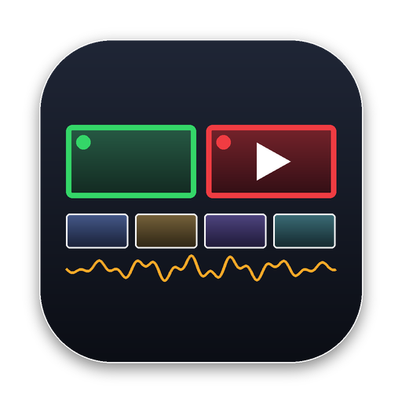

  

<h1 align="center">RegiaLive</h1>

<b>The live TV control room for Mac.</b> 
Multiple cameras, remote guests, animated broadcast graphics, streaming and recording — in one app.

  <a href="https://github.com/LOLLO80808/regialive/releases/latest"><b>⬇️ Download for Mac (free)</b></a> ·
  <a href="https://regialive.lemonsqueezy.com"><b>⭐ Get RegiaLive Pro</b></a> ·
  <a href="https://LOLLO80808.github.io/regialive">Website</a> ·
  <a href="#italiano">🇮🇹 Italiano</a>

---

## Why RegiaLive

- **Any camera.** Webcams, HDMI/SDI capture cards, NDI® sources, screen and window capture, any web page with transparency.
- **Remote guests in one click.** Send a link: guests join from any phone or computer, no app. They see your program, hear everything except themselves (mix-minus) and see their own tally.
- **Real broadcast graphics.** Animated lower thirds, tickers, scoreboards, countdowns, live data from the web, Google Sheets and news feeds. Video with alpha, sound in graphics.
- **A real switcher.** Preview/Program, transitions and stingers, 4 overlay channels, scenes and split screens, multiview, instant replay, audio mixer with headphones in real time.
- **Out to everywhere.** RTMP/RTMPS streaming to YouTube, Twitch, Facebook, recording, NDI®, external screens, virtual webcam.
- **Built for the Mac.** Metal engine at constant frame rate, Apple Silicon native, smooth even under load.

## Free vs Pro

| | Free | **Pro** |
|---|:---:|:---:|
| Every feature | ✅ | ✅ |
| Cameras, guests, graphics, streaming, recording | ✅ | ✅ |
| "RegiaLive" mark on outputs | small mark | **none** |
| Updates for the current major version | ✅ | ✅ |
| Priority support | — | ✅ |

**RegiaLive Pro is a one-time purchase** (no subscription), valid on 2 Macs. → [Buy RegiaLive Pro](https://regialive.lemonsqueezy.com)

## Requirements

macOS 14 Sonoma or later · Apple Silicon or Intel

## Install

1. Download the latest `.dmg` from [Releases](https://github.com/LOLLO80808/regialive/releases/latest).
2. Drag **RegiaLive** into **Applications**.
3. Open it and allow Camera, Microphone and Screen Recording when asked.

## Help & feedback

- 🐞 [Report a bug](https://github.com/LOLLO80808/regialive/issues/new?template=bug.yml)
- 💡 [Suggest a feature](https://github.com/LOLLO80808/regialive/issues/new?template=idea.yml)
- 💬 [Discussions](https://github.com/LOLLO80808/regialive/discussions)

---

## 🇮🇹 Italiano

**RegiaLive è la regia TV in diretta per Mac.** Più telecamere, ospiti in collegamento, grafiche animate da TV, streaming e registrazione in un'unica app.

- **Qualsiasi telecamera**: webcam, schede di acquisizione HDMI/SDI, sorgenti NDI®, cattura dello schermo, pagine web con trasparenza.
- **Ospiti in collegamento con un link**, da telefono o computer, senza app: vedono il tuo Program, sentono tutto tranne sé stessi e vedono la tally.
- **Grafiche da TV**: sottopancia, ticker, tabelloni, conti alla rovescia, dati in diretta da internet e da Google Fogli, notizie RSS.
- **Mixer video vero**: Preview/Program, transizioni e stinger, overlay, scene e split screen, multiview, replay, mixer audio.
- **Diretta ovunque**: YouTube, Twitch, Facebook, registrazione, NDI®, schermi esterni.

**Gratis** con tutte le funzioni (sulle uscite compare una piccola scritta «RegiaLive»). **RegiaLive Pro** toglie la scritta: un solo pagamento, niente abbonamento, valida su 2 Mac. → [Compra RegiaLive Pro](https://regialive.lemonsqueezy.com)

[⬇️ Scarica RegiaLive per Mac](https://github.com/LOLLO80808/regialive/releases/latest)

---

NDI® is a registered trademark of Vizrt NDI AB. RegiaLive is not affiliated with Apple, Vizrt, YouTube, Twitch or Meta.
